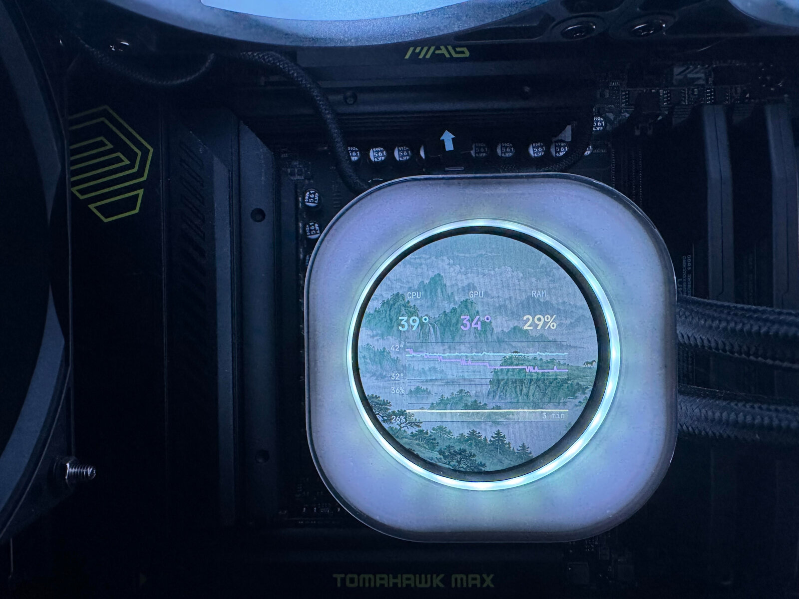
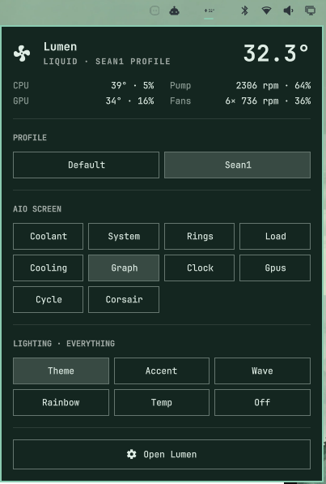

# Lumen for iCUE LINK

An [Omarchy](https://omarchy.org) bar widget for [lumen](https://github.com/pxSean/lumen), which controls a Corsair iCUE LINK System Hub and the iCUE LINK AIO LCD screen on Linux.

<p align="center"></p>

The bar shows a fan icon and the coolant temperature. It turns the urgent color while lumen's coolant safety override is running fans and pump at full speed.

- **Left click** opens a panel with CPU, GPU and coolant temperatures, pump and fan speeds, and one-click buttons for fan profiles, AIO screen layouts and lighting presets.
- **Right click** opens the Lumen TUI.

<p align="center"></p>

## Requirements

This widget is a front end only. **Install lumen first.** It's the daemon that talks to the hardware, and every reading and button in the widget goes through it.

Building lumen needs the Rust toolchain (`sudo pacman -S rust`, or [rustup](https://rustup.rs)). Then build the lumen release this widget is tested with, [v0.1.0](https://github.com/pxSean/lumen/tree/v0.1.0), pinned to its exact commit:

```bash
git clone https://github.com/pxSean/lumen.git
cd lumen
git checkout --detach c737f906225646eadc418e5c16b4069dc1907511   # lumen v0.1.0
./install.sh
```

`install.sh` builds `lumend`, `lumenctl` and the `lumen` TUI into `~/.local/bin`, installs a udev rule (it asks for your password for that step), and starts `lumend` as a systemd user service.

## Install

```bash
omarchy plugin add https://github.com/pxSean/omarchy-lumen.git --enable
```

The widget goes in the right section of the bar. To turn off the temperature next to the icon, use the widget's **Show coolant temperature** setting.

If the panel says **LUMEN NOT INSTALLED**, lumen isn't in `~/.local/bin`; follow [Requirements](#requirements). If it says **LUMEND NOT RUNNING**, start the daemon with `systemctl --user start lumend`.

## Remove

Remove the widget:

```bash
omarchy plugin remove pxsean.lumen
```

To remove lumen as well:

```bash
systemctl --user disable --now lumend
rm ~/.local/bin/{lumend,lumenctl,lumen}
rm ~/.config/systemd/user/lumend.service ~/.local/share/applications/lumen.desktop
sudo rm /etc/udev/rules.d/70-lumen.rules
rm -r ~/.config/lumen   # your profiles and screen settings
```

When `lumend` stops, the hub goes back to its onboard fan curve, and the AIO screen goes back to Corsair's firmware screen.

## License

GPL-3.0-or-later, like lumen.
